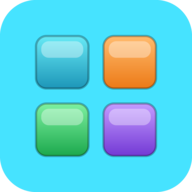

<p align="center">
  
</p>

# Block Blast

A self-contained Block Blast clone — drag pieces onto an 8×8 grid, fill rows and columns to clear them, chase combos and streaks. Built as a single `index.html` with no build step, no server, and no network calls after the first page load.

**Play it now:** [https://tcottrill.github.io/myBlockBlast/](https://tcottrill.github.io/myBlockBlast/)

The whole game — markup, CSS, JavaScript, tile rendering, and synthesized sound effects — lives inside one HTML file. The only sidecar files are the PWA icons and the web app manifest.

## Free and open

Released into the **public domain** under the [Unlicense](LICENSE). 100% free:

- No purchase, subscription, or in-app payment.
- No ads, no trackers, no analytics.
- No account or sign-in.
- No network calls — once the page is loaded, the game runs entirely on your device.

You may copy, modify, redistribute, or sell it for any purpose.

## How to play

1. Three pieces appear in the tray at the bottom.
2. Drag a piece onto the grid. A floating preview rides about 80 px above your finger so you can see what you are placing. A green outline means the piece fits; red means it does not.
3. Release on a valid spot to drop the piece. Release outside the grid (or on an invalid spot) and the piece snaps back to the tray.
4. Whenever a row **or** a column is completely filled, those eight tiles shatter and you score.
5. When all three tray pieces have been placed, three fresh pieces appear.
6. The game ends when none of the remaining tray pieces can fit anywhere on the board.

### Modes

Choose a mode on the main menu:

- **Classic:** board-aware dealing gives every fresh tray at least one legal way to place all three pieces, including any clears along the way. The tray is shuffled; choosing the wrong order or positions can still end a run.
- **Hard:** unrestricted random pieces, like the original version of this project. A new tray can be impossible.
- **Daily:** Hard's unrestricted dealing with a repeatable piece sequence seeded by the local calendar date. Every attempt on that date uses the same sequence; animations cannot change it. Unlimited retries let you improve your daily best. This is an endless score challenge, not a finite level.

Best scores are separate for Classic, Hard, and each Daily date. Existing best scores remain Classic records. Continue restores the saved mode, combo, and Daily sequence, even after midnight; Play Again starts today's challenge. There is one saved run shared across modes, so starting a new game replaces it.

### Scoring

- **+1** for each tile placed.
- **Line points:** `10 × lines²`: 1 line → 10, 2 → 40, 3 → 90, 4 → 160. Rows and columns count together.
- **Combo multiplier:** the first clearing move starts combo 1. Each subsequent clearing move increases it by one and multiplies line points, capped at ×8. Up to two non-clearing placements preserve it; the third resets it. A multi-line clear increases the combo once.
- **All clear:** +300 when a clearing move empties the entire board, outside the multiplier.
- Placement points are never multiplied. Example: a 4-cell piece clearing two lines at combo 3 earns `4 + 40 × 3 = 124` points (424 if it also empties the board).

All modes use these rules. The combo indicator shows the current multiplier and how many placements remain to clear again. Old saves resume under the new rules without changing points already earned.

These are deliberate **Classic-inspired approximations**, not a claim to reproduce Hungry Studio's proprietary scoring or piece algorithm. The [official app listing](https://apps.apple.com/us/app/block-blast/id1617391485) describes combos without specifying a formula. Solvable Classic trays and the Hard/Daily modes are this project's own design choices.

There is no undo — every placement is committed. Plan ahead.

## Install on your phone

The game is a Progressive Web App. Once it is hosted over HTTPS (for example on GitHub Pages), you can install it to your home screen and play full-screen.

- **iPhone / iPad (Safari)** — open the site in Safari, tap the **Share** button, then **Add to Home Screen**.
- **Android (Chrome)** — open the site, tap the three-dot menu, then **Install app** (or **Add to Home Screen**).
- **Desktop (Chrome / Edge)** — click the install icon in the address bar.

Once installed, the app runs full-screen with no browser chrome and works offline.

## File inventory

```
myBlockBlast/
├── index.html                       # entire app
├── site.webmanifest                 # PWA manifest
├── icon-master.svg                  # vector source for icons
├── icon-192.png                     # PWA icon
├── icon-512.png                     # PWA icon
├── apple-touch-icon.png             # iOS home-screen icon (180×180)
├── apple-touch-icon-167x167.png
├── apple-touch-icon-152x152.png
├── favicon.ico
├── favicon-16x16.png
├── favicon-32x32.png
├── README.md                        # this file
├── PROMPT.md                        # regeneration spec
└── LICENSE                          # Unlicense
```

## Running locally

The game is a single static file. Open `index.html` directly in any modern browser — no server required:

```sh
# Windows
start index.html

# macOS
open index.html

# Linux
xdg-open index.html
```

For PWA install testing you need HTTPS, which `file://` and plain `http://` cannot provide. Deploy to GitHub Pages or any static host.

## Verification

Run `node --test tests/game.test.cjs` (Node.js 18 or later). Tests cover scoring, combo expiry, independent whole-tray solvability, mode records, Daily replay/resume, legacy saves, and the existing board checks. The original browser checks also remain available with `?test=1`.

Optional UI smoke check: with Playwright and Microsoft Edge installed, run `node tests/browser-smoke.cjs`. This exercises real pointer input, reload/Continue, all three mode selections, viewport bounds, and browser errors. Set `SMOKE_SCREENSHOT_DIR` to an existing directory to save preview images.

## Regenerating from a prompt

`PROMPT.md` is a self-contained brief for the project. Paste it into [claude.ai](https://claude.ai) — or any capable LLM — and you should get back a working single-file implementation that matches this repository.

## Credits

Inspired by the mobile game **Block Blast!**. This is an independent open-source homage; it shares no code, art, or copyrighted material with the original.

### Contributors

- **tcottrill** — project owner, direction, and review.
- **Claude (Anthropic)** — co-author of the design spec and the initial implementation.

## License

[Unlicense](LICENSE) — public domain.
